# Auto-create and publish AI social videos with Telegram, GPT-4 and Blotato

Adapt the published “Auto-create and publish AI social videos with Telegram, GPT-4 and Blotato” workflow to other implementations while preserving its documented behavior.

**Specification: source-derived draft.** The source contains 37 executable nodes and 37 connections. This draft is derived from the n8n export; it needs a human-reviewed purpose, input/output contract, and behavioral tests before a port can claim equivalence.

[Specification](specification.md) · [Machine-readable record](agent.json) · [Schemas](schemas/README.md) · [Fixtures](fixtures/README.md) · [Evidence](evaluations/README.md)

## Workflow

This initial Mermaid map preserves the source graph, including non-main connections and port numbers. It is an implementation-derived starting point for the shared design; it does not execute the workflow or prove its behavior. Disabled-node details and exact expressions remain in the source.

```mermaid
flowchart LR
  n0["Upload Video to Blotato"]
  n1["Post to Instagram"]
  n2["Post to YouTube"]
  n3["Post to TikTok"]
  n4["Post to Facebook Page"]
  n5["Post to Threads"]
  n6["Post to Twitter #40;X#41;"]
  n7["Post to LinkedIn"]
  n8["Post to Bluesky"]
  n9["Post to Pinterest"]
  n10["Trigger Telegram Prompt or Image"]
  n11["Split Prompt or Image Input"]
  n12["Condition Input Type #40;Image or Text#41;"]
  n13["Download Image from Telegram"]
  n14["Extract Image File URL"]
  n15["Upload Image to Cloudinary"]
  n16["Convert Image to Video"]
  n17["Wait for Image-to-Video Rendering"]
  n18["Get Image-Based Video URL"]
  n19["Generate Video with blotato"]
  n20["Wait for blotato Video Rendering"]
  n21["Get blotato Video URL"]
  n22["Merge Video Data #40;Image or Prompt#41;"]
  n23["Generate Music with Piapi"]
  n24["Wait for Music Generation"]
  n25["Get Music File URL"]
  n26["Generate Script #40;GPT-4o-mini#41;"]
  n27["Split Script"]
  n28["Merge Video #43; Music"]
  n29["Wait for Fusion Completion"]
  n30["Get Final Video URL"]
  n31["Generate Social Caption #40;GPT-4#41;"]
  n32["Generate SEO Title #40;GPT-4#41;"]
  n33["Append Video Data to Google Sheet"]
  n34["Send Final Video to Telegram"]
  n35["Send Caption to Telegram"]
  n36["Assign Platform IDs for Blotato"]
  n27 -->|"main out 0 to in 0"| n28
  n25 -->|"main out 0 to in 0"| n26
  n30 -->|"main out 0 to in 0"| n31
  n28 -->|"main out 0 to in 0"| n29
  n21 -->|"main out 0 to in 0"| n22
  n16 -->|"main out 0 to in 0"| n17
  n14 -->|"main out 0 to in 0"| n15
  n0 -->|"main out 0 to in 0"| n1
  n0 -->|"main out 0 to in 0"| n2
  n0 -->|"main out 0 to in 0"| n3
  n0 -->|"main out 0 to in 0"| n4
  n0 -->|"main out 0 to in 0"| n5
  n0 -->|"main out 0 to in 0"| n6
  n0 -->|"main out 0 to in 0"| n7
  n0 -->|"main out 0 to in 0"| n8
  n0 -->|"main out 0 to in 0"| n9
  n35 -->|"main out 0 to in 0"| n36
  n23 -->|"main out 0 to in 0"| n24
  n18 -->|"main out 0 to in 0"| n22
  n24 -->|"main out 0 to in 0"| n25
  n32 -->|"main out 0 to in 0"| n33
  n15 -->|"main out 0 to in 0"| n16
  n29 -->|"main out 0 to in 0"| n30
  n19 -->|"main out 0 to in 0"| n20
  n11 -->|"main out 0 to in 0"| n12
  n13 -->|"main out 0 to in 0"| n14
  n34 -->|"main out 0 to in 0"| n35
  n26 -->|"main out 0 to in 0"| n27
  n36 -->|"main out 0 to in 0"| n0
  n31 -->|"main out 0 to in 0"| n32
  n10 -->|"main out 0 to in 0"| n11
  n20 -->|"main out 0 to in 0"| n21
  n33 -->|"main out 0 to in 0"| n34
  n17 -->|"main out 0 to in 0"| n18
  n22 -->|"main out 0 to in 0"| n23
  n12 -->|"main out 0 to in 0"| n19
  n12 -->|"main out 1 to in 0"| n13
```

[Diagram source](workflow.mmd)

## Implementations

| Implementation | Status |
|---|---|
| [n8n](implementations/n8n/README.md) | Sanitized source available; not runtime-tested |
| [Plain Python](implementations/python/README.md) | Planned |
| [Pydantic AI](implementations/pydantic-ai/README.md) | Planned |
| [CrewAI Flow](implementations/crewai-flow/README.md) | Planned |
| [CrewAI Crew](implementations/crewai-crew/README.md) | Planned |
| [LangGraph](implementations/langgraph/README.md) | Planned |

## Build or operate with an assistant

[Claude](prompts/claude.md) · [Codex](prompts/codex.md) · [Grok Bot](prompts/grok-bot.md) · [Muse](prompts/muse.md) · [Dots](prompts/dots.md)

Build instructions and operating instructions are separate. These are untested prompts, not additional working implementations.

## Attribution

Curated by Nik Bear Brown. Preserve the [n8n source provenance](implementations/n8n/provenance.json), [configuration record](implementations/n8n/configuration.json), and [license notice](../../licenses/zie619-mit.txt). Ported implementations must retain applicable upstream attribution; the repository has no blanket license replacing source licenses.
