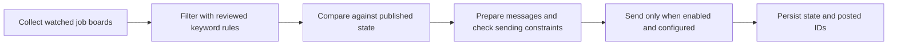

# Lectern job search

Collect, filter and compare job postings, then prepare controlled Discord updates.

[Specification](specification.md) · [Metadata](agent.json) · [Evidence](evaluations/README.md)

## Implementations

The [n8n implementation](implementations/n8n/README.md) contains five workflows, fixtures and preserved test reports. The Python reference exists outside this repository; an imported Python implementation and other ports are planned. Read the implementation README for exact test scope and known limitations.

- [n8n](implementations/n8n/README.md): reported-fixture-tested
- [Plain Python](implementations/python/README.md): planned
- [Pydantic AI](implementations/pydantic-ai/README.md): planned
- [CrewAI Flow](implementations/crewai-flow/README.md): planned
- [CrewAI Crew](implementations/crewai-crew/README.md): planned
- [LangGraph](implementations/langgraph/README.md): planned

## Assistant instructions

[Claude](prompts/claude.md) · [Codex](prompts/codex.md) · [Grok Bot](prompts/grok-bot.md) · [Muse](prompts/muse.md) · [Dots](prompts/dots.md)

Curated by Nik Bear Brown. Preserve source attribution and distinguish reported test evidence from new execution.
